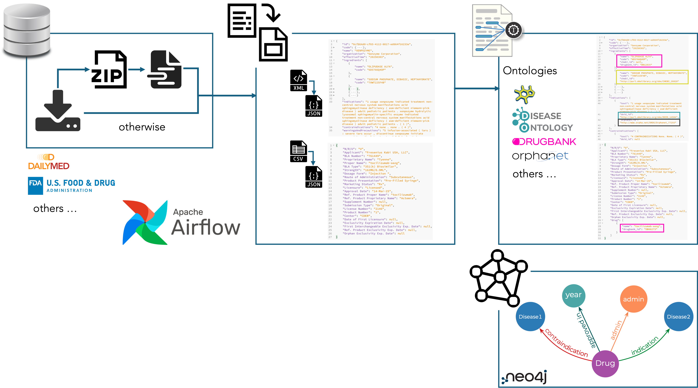

<div id="top"></div>

<!-- PROJECT LOGO -->
<br />
<div style="display: flex; align-items: center;">
    <div style="flex: 1;">
        <a href="https://isel.pt" target="_blank">
            
        </a>
    </div>
    <div style="flex: 3; text-align: left; padding-left: 20px;">
        <h3>MedJsonify</h3>
    </div>
</div>

[](https://www.python.org/)
[](https://www.docker.com/)
[](https://airflow.apache.org)
[](https://neo4j.com/)
[](https://www.nltk.org)
[](https://pandas.pydata.org)

## Overview

MedJsonify is a biomedical data pipeline that collects FDA regulatory data (DailyMed, Purple Book, Orange Book), converts it to a uniform JSON representation with [jsonifyer](https://github.com/crpereir/jsonifyer), links drugs and diseases to biomedical ontologies, and builds a knowledge graph in Neo4j.

The graph has four node types (**Drug** = active ingredient, **Disease**, **AdminRoute**, **ApprovalYear**) and four relations:

| Relation | From → to | Source |
|---|---|---|
| `has_indication` | Drug → Disease | DailyMed *Indications and Usage* section (LOINC 34067-9) |
| `has_contraindication` | Drug → Disease | DailyMed *Contraindications* section (LOINC 34070-3) |
| `has_administration` | Drug → AdminRoute | DailyMed route, Purple Book route, Orange Book `DF;Route` |
| `has_approved_year` | Drug → ApprovalYear | FDA application approval date (Orange Book / Purple Book) |

The pipeline can run in two ways, using the same code and folders:

- **Airflow mode**: the DAGs schedule and run the whole pipeline (typically monthly).
- **Standalone mode**: a light Docker image runs each step on its own, without Airflow (`standalone/`).

<div align="center">
  
</div>

## Table of Contents

1. [Project Structure](#project-structure)
2. [Key Features](#key-features)
3. [Technologies](#technologies)
4. [Data Sources and Ontologies](#data-sources-and-ontologies)
5. [Installation](#installation)
6. [Usage Guide](#usage-guide)
7. [Pipeline Workflow](#pipeline-workflow)
8. [Reproducing the Paper](#reproducing-the-paper)
9. [Troubleshooting](#troubleshooting)
10. [License](#license)
11. [How to Cite](#how-to-cite)

## Project Structure

```
MedJsonify/
├── img/                              # Images and documentation resources
├── airflow/
│   └── dags/
│       ├── utils/
│       │   ├── config.py
│       │   └── tasks.py              # Task functions (used by both modes)
│       ├── airflow.ini
│       ├── converter_dag.py          # Conversion only
│       ├── create_user.py
│       ├── jsonify_dag.py            # Complete pipeline
│       ├── neo4j_dag.py              # Graph construction
│       └── ner_dag.py                # NER only
│
├── upload/                           # Data acquisition
│   ├── download_from_url.py
│   ├── extract_files.py
│   ├── unzip_directories.py
│   └── upload_loader.py
│
├── jsonify/                          # Conversion (jsonifyer)
│   ├── conversion.py                 # Main conversion driver
│   ├── jsonify.ini
│   ├── purple_book.py                # Keeps only the Purple Book full product list
│   ├── conversion_stats.py           # Conversion table (files, records, duplicates, failures)
│   ├── spl_to_json.xsl               # XSLT stylesheet for SPL labels (comparison)
│   └── xml_strategy_comparison.py    # Python vs XSLT on the same labels
│
├── NER/                              # Entity recognition and linking
│   ├── Biomedical_preprocessing.py   # Abbreviations, negations, populations, organisms
│   ├── ner_entities.py               # Drug and disease linking
│   ├── ner_entities_batch.py         # Batch processing
│   ├── ner_drugbank.py               # DrugBank matching (UNII, names, fuzzy)
│   ├── ner_metrics.py                # Run report (ontology versions, counts)
│   ├── download_vocabulary.py
│   ├── logging_config.py
│   ├── bioner.ini                    # Vocabulary and ontology configuration
│   ├── ontologies/
│   │   ├── data/                     # Processed lexicons, *_version.txt
│   │   └── scripts/                  # process_ontology.sh, extract_entities.sh
│   └── data/
│       ├── entities/                 # NER output
│       ├── preprocessing/            # Preprocessed JSON
│       └── stats/                    # NER metrics, dataflow counts
│
├── database/                         # Knowledge graph
│   ├── knowledge_graph.py            # Graph loading, route normalization, ontology cleanup
│   ├── disease_mapping.py            # ORDO/HPO → DO equivalences
│   ├── approval_years.py             # Approval year from the FDA application
│   ├── graph_export.py               # indicated.csv / contraindicated.csv
│   ├── dataflow_stats.py             # Entity and relation counts per stage (S2–S4)
│   ├── compare_benchmarks.py         # Validation against Hetionet / PharmacotherapyDB / DrugCentral
│   ├── benchmarks/                   # Reference files and results
│   ├── output/                       # Exported CSV files
│   └── neo4j.ini
│
├── standalone/                       # Run without Airflow
│   ├── run_medjsonify.sh             # Runner (one step or the whole pipeline)
│   ├── run_task.py
│   ├── Dockerfile                    # Light image (no Airflow)
│   ├── jsonifyer_python_converter.py # Patched jsonifyer converter
│   ├── fetch_ontologies.py           # Downloads and processes the ontologies
│   ├── check_imports.py
│   ├── requirements-extra.txt
│   ├── dataflow_queries.md           # All Cypher queries of the paper, with expected values
│   └── README.md                     # Standalone mode in detail
│
├── figures/                          # Scripts and data of the paper's charts
├── DECISIONS.md                      # Design decisions taken from the results
├── Dockerfile                        # Airflow image
├── docker-compose.yml
├── docker.sh
├── setup.sh
└── requirements.txt
```

## Key Features

- **Multi-format conversion**: XML (DailyMed SPL), CSV (Purple Book) and TXT (Orange Book) to JSON with jsonifyer, with deduplication and a conversion report that separates duplicates, malformed records and genuine failures.
- **Drug linking**: only ingredients marked as active in the label (SPL class code `ACT*`) become drugs; each is linked to DrugBank by UNII code, then by exact name or synonym, by name without salt words, and by fuzzy matching, with ChEBI as a fallback.
- **Disease linking**: Disease Ontology, then Orphanet, then HPO (restricted to *Phenotypic abnormality*), one link per text span with the longest match kept; Orphanet and HPO terms are mapped to the equivalent DO term when one exists.
- **Relation typing**: by label section, with rules that remove negated statements ("not indicated"), at-risk populations and ambiguous short words.
- **Graph construction**: uniqueness constraints, normalized administration routes, approval years from the FDA application, and an ontology cleanup of generic and non-disease terms.
- **Two execution modes**: Apache Airflow, or a standalone Docker runner that runs each step separately.
- **Reproducibility**: ontology versions recorded at each run; all queries, counts and chart scripts of the paper are included.

## Technologies

- **Python** (3.8 in the Docker images)
- **jsonifyer**: conversion of XML, CSV and TXT files to JSON
- **lxml**: XML processing and XSLT transformations
- **NLTK**: text preprocessing
- **Pandas**: tabular data
- **Neo4j 5**: graph database
- **Apache Airflow**: workflow orchestration
- **Docker**: containerized execution

## Data Sources and Ontologies

| Source | What is used | Format |
|---|---|---|
| DailyMed | Human prescription labels of the monthly update | XML (SPL) |
| Purple Book | Full product list of the monthly data file (the change report at the top is removed) | CSV |
| Orange Book | `products.txt` (patent and exclusivity files are not used) | TXT |

### Ontologies and vocabularies

| Resource | Acronym | Used for | Notes |
|---|---|---|---|
| DrugBank vocabulary | DB | Drugs (first choice) | Matched by UNII, then by name |
| ChEBI | CHEBI | Drugs (fallback) | `chebi_lite.owl` |
| Disease Ontology | DOID | Diseases (first choice) | |
| Orphanet Rare Disease Ontology | ORDO | Rare diseases | Mapped to DO when equivalent |
| Human Phenotype Ontology | HPO | Phenotypes | Only *Phenotypic abnormality* (HP:0000118) |

Each run records the version and checksum of every ontology in `NER/ontologies/data/<name>_version.txt`.

## Installation

### Prerequisites

- Docker and Docker Compose
- Git

### Setup

1. Clone the repository and enter it:
   ```bash
   git clone https://github.com/matpato/MedJsonify.git
   cd MedJsonify
   ```

2. Grant execution permissions to the scripts:
   ```bash
   chmod +x docker.sh NER/ontologies/scripts/*.sh
   ```

3. **Airflow users** (Airflow mode only), in `airflow/dags/airflow.ini`:
   ```ini
   [USER]
   username = admin
   firstname = Admin
   lastname = User
   role = Admin
   email = admin@example.com
   password = admin
   ```

4. **Vocabulary and ontologies**, in `NER/bioner.ini`.

   4.1. **Vocabulary**:
   ```ini
   [VOCABULARY]
   drugbank_url = https://go.drugbank.com/releases/5-1-13/downloads/all-drugbank-vocabulary
   ```

   4.2. **Ontology processing**:
   ```ini
   [ONTO]
   active_lexicons = doid, chebi, hp, ordo
   # Re-download and rebuild the ontologies at startup (1) or use the local versions (0)
   update = 0
   ```
   Use `update = 0` to reproduce a run with the same ontology versions, and `update = 1` to download the latest releases.

   4.3. **Ontology URLs**: one URL per line, without `#` comments on the same line. For example:
   ```ini
   [ONTOLOGIES]
   doid_url  = http://purl.obolibrary.org/obo/doid.owl
   hpo_url   = http://purl.obolibrary.org/obo/hp.owl
   chebi_url = http://purl.obolibrary.org/obo/chebi/chebi_lite.owl
   ordo_url  = https://www.orphadata.com/data/ontologies/ordo/last_version/ORDO_en_4.8.owl
   ordo_name = ordo
   ```
   The OBO Foundry URLs resolve to the latest release. To fix a version, use a dated URL (e.g. `http://purl.obolibrary.org/obo/doid/releases/2025-05-30/doid.owl`); for an older ORDO release, use a file from `.../ordo/previous_versions/` (zipped files are unzipped automatically in standalone mode).

## Usage Guide

### Airflow mode

1. Build and run the containers:
   ```bash
   ./docker.sh
   ```
   Note: `docker.sh` runs `docker-compose down -v`, which also deletes the Neo4j data volume. Remove `-v` to keep the graph between runs.

2. Open Airflow at <http://localhost:8080> (default user `admin`, password `admin`).

3. Activate and trigger a DAG:
   - `converter_dag`: conversion to JSON only
   - `ner_dag`: NER on the converted JSON
   - `medjsonify_dag`: the complete pipeline

4. Open the Neo4j Browser at <http://localhost:7474> (user `neo4j`, password `testpassword`).

### Standalone mode

Runs the same task functions in a light image without Airflow. Every command is run from the main folder:

```bash
bash standalone/run_medjsonify.sh --list              # build the image, list the tasks
bash standalone/run_medjsonify.sh                     # whole pipeline
bash standalone/run_medjsonify.sh --step convert      # one step
bash standalone/run_medjsonify.sh --from preprocess   # from a step to the end
bash standalone/run_medjsonify.sh --shell 'ls NER/ontologies/data'   # any command in the container
```

Steps: `download → convert → stats → ontologies → vocabulary → preprocess → ner → validate → graph → export`.
After changing `requirements.txt`, the Dockerfile or `standalone/jsonifyer_python_converter.py`, rebuild with `--rebuild`.
See [`standalone/README.md`](standalone/README.md) for all options.

## Pipeline Workflow

1. **Data acquisition**: download the monthly files (DailyMed, Purple Book, Orange Book) and extract the archives.
2. **Conversion**: jsonifyer converts each source to JSON. DailyMed labels are deduplicated by product name, Purple Book rows by proper name and Orange Book rows by active ingredient; the Purple Book file is reduced to its full product list first. A conversion report is written to `jsonify/stats/`.
3. **Ontologies and vocabulary**: download and process the ontologies listed in `bioner.ini` and the DrugBank vocabulary.
4. **Preprocessing**: expand abbreviations (case-sensitive), remove negated statements and at-risk populations from indications, and map organism names to infections.
5. **NER and linking**: link active ingredients to DrugBank/ChEBI and diseases to DO, Orphanet and HPO.
6. **Validation**: report, per folder, how many records have drug and disease links.
7. **Graph construction**: load Neo4j with uniqueness constraints; map Orphanet/HPO diseases to DO; normalize routes; take approval years from the FDA application; remove generic terms, non-disease terms and ambiguous short mentions (ontology cleanup).
8. **Export**: `database/output/indicated.csv` and `contraindicated.csv` (drug, disease pairs; pairs that are both indicated and contraindicated are left out of `indicated.csv`).

## Reproducing the Paper

The counts, tables and figures of the paper come from one run on the May 2025 data.

```bash
# Conversion table
bash standalone/run_medjsonify.sh --step convert --ds 2025-05-01
cat jsonify/stats/conversion_results_2025-05-01.txt

# NER and graph
bash standalone/run_medjsonify.sh --from ontologies --ds 2025-05-01

# Entity and relation counts per stage (S2–S4)
bash standalone/run_medjsonify.sh --shell 'python3 /opt/airflow/dags/database/dataflow_stats.py NER/data/entities --out-dir NER/data/stats'

# Validation against Hetionet
bash standalone/run_medjsonify.sh --step export
bash standalone/run_medjsonify.sh --shell 'python3 /opt/airflow/dags/database/compare_benchmarks.py evaluate --indicated /opt/airflow/dags/database/output/indicated.csv --obo /opt/airflow/dags/database/benchmarks/doid.obo --hetionet-pairs /opt/airflow/dags/database/benchmarks/hetionet_indicated.csv --out /opt/airflow/dags/database/benchmarks/results'

# Python vs XSLT conversion on the same labels
bash standalone/run_medjsonify.sh --shell 'python3 /opt/airflow/dags/jsonify/xml_strategy_comparison.py /opt/airflow/dags/jsonify/input/xml_files --xslt /opt/airflow/dags/jsonify/spl_to_json.xsl --out /opt/airflow/dags/jsonify/stats'
```

- **Cypher queries** for every table, figure and use case, with the values they return on the released graph: [`standalone/dataflow_queries.md`](standalone/dataflow_queries.md).
- **Charts** drawn with Python (approval years, routes, drug degrees, posaconazole): `figures/`.
- **Design decisions** taken from the results, with their effect on the numbers: [`DECISIONS.md`](DECISIONS.md).

Before a clean run, empty the "already converted" lists (`jsonify/data/*_processed.txt`); otherwise jsonifyer skips records it has seen and numbers the new ones from `record_1`, overwriting existing output files.

## Troubleshooting

#### 1. Ontology processing fails

**Symptom**: `ERROR: Missing script: process_ontology.sh`

```bash
chmod +x NER/ontologies/scripts/*.sh
# Airflow mode:
docker-compose exec airflow chmod +x /opt/airflow/dags/NER/ontologies/scripts/*.sh
```

#### 2. Entity extraction returns nothing

**Symptom**: `No entities found` for known terms, or `0 processed` in the NER log.

```bash
ls -lh NER/ontologies/data/*_links.tsv NER/ontologies/data/*_version.txt
head NER/ontologies/data/doid_word1.txt
./NER/ontologies/scripts/extract_entities.sh "diabetes" doid ./NER/ontologies/data
```

- Process the missing ontology again (standalone: `--step ontologies --force-ontologies`).
- Check that the lexicon name matches (`doid`, not `do`).
- `0 processed, 0 failed`: `process_file_in_batch` must unpack the `metrics` value as well.

#### 3. DrugBank matching fails

**Symptom**: no `drugbank_id` in the output.

```python
from NER.ner_drugbank import load_drugbank_data, create_vocabulary
drugbank = load_drugbank_data('NER/data/drugbank_vocabulary.csv')
vocab = create_vocabulary(drugbank)
print(len(vocab), list(vocab)[:10])
```

- Download the vocabulary again (`download_vocabulary_task`).
- The `match` field of each drug shows how it was linked (`unii`, `exact`, `exact_parent`, `fuzzy`); fuzzy matching uses Jaro–Winkler ≥ 0.88.

#### 4. `KeyError: '@'` in jsonifyer

The published jsonifyer fails on attribute pairs such as `@classCode`. The Docker images install the patched converter (`standalone/jsonifyer_python_converter.py`); rebuild with `--rebuild`.

#### 5. Neo4j connection refused

**Symptom**: `ServiceUnavailable: Unable to retrieve routing information`

```bash
docker-compose ps neo4j
docker-compose restart neo4j
docker-compose logs neo4j
```

#### 6. Import errors

**Symptom**: `ModuleNotFoundError: No module named 'NER'` (Airflow), or `ModuleNotFoundError: No module named 'requests'` (standalone).

- Airflow: `PYTHONPATH` in `docker-compose.yml` must include `/opt/airflow/dags`.
- Standalone: add the package to `standalone/requirements-extra.txt`, then `bash standalone/run_medjsonify.sh --rebuild --check`.

#### 7. The Neo4j Browser does not show the whole graph

Raise the display limits before drawing a large subnetwork:

```
:config initialNodeDisplay: 5000
:config maxNeighbours: 5000
:config maxRows: 5000
```

After changing the loading code, empty the graph (`MATCH (n) DETACH DELETE n;`) before loading it again: `MERGE` never removes old nodes.

### Performance

- **Parallelism**: `max_workers` in `ner_entities_batch.py` (default 4).
- **Memory**: lower `splitedSize` in `[SAMPLE]` of `bioner.ini`, or remove ontologies from `active_lexicons`.

## Appendix

### Ontology URLs

| Ontology | URL | Size |
|---|---|---|
| DOID | http://purl.obolibrary.org/obo/doid.owl | ~40 MB |
| ChEBI (lite) | http://purl.obolibrary.org/obo/chebi/chebi_lite.owl | ~200 MB |
| HPO | http://purl.obolibrary.org/obo/hp.owl | ~50 MB |
| ORDO | https://www.orphadata.com/data/ontologies/ordo/last_version/ORDO_en_4.8.owl | ~100 MB |

### `process_ontology.sh`

```bash
./process_ontology.sh <ontology_file> [output_dir]
./process_ontology.sh doid.owl data/
```

- `MIN_ENTITY_SIZE_ALPHA=3`: minimum alphabetic characters
- `MAX_ENTITY_SIZE_DIGIT=5`: maximum consecutive digits
- `REMOVE_OBSOLETE=1`: remove obsolete concepts
- Writes `<name>_version.txt` (version, checksum, processing date)

### `extract_entities.sh`

```bash
./extract_entities.sh [--no-uri] <text> <lexicon_name> [data_dir]
./extract_entities.sh 'diabetes mellitus' doid data/
DEBUG=1 ./extract_entities.sh 'test' doid data/
```

- `USE_STOPWORDS=1`, `MIN_WORD_LENGTH=3`, `DEBUG=0`

## License

This project is licensed under the MIT License; see the LICENSE file.

## How to Cite

If you use MedJsonify in your research, please cite:

```bibtex
@inproceedings{11216837,
   author   = {Pereira, Ana Carolina and Pato, Matilde and Datia, Nuno},
   booktitle= {2025 29th International Conference Information Visualisation (IV)}, 
   title    = {Mapping Drug Interactions and Therapeutic Clusters through Knowledge Graph Visualization}, 
   pages    = {389-395},
   year     = {2025},
   doi      = {10.1109/IV68685.2025.00074}
}

@inproceedings{Pereira2025,
  author    = {Pereira, Ana Carolina and Pato, Matilde and Datia, Nuno},
  title     = {Knowledge Graphs as Educational Tools in Biomedical Education},
  booktitle = {12th ACM Celebration of Women in Computing: womENcourage 2025},
  year      = {2025}
}
```

The drug–disease pairs produced by MedJsonify are released on Zenodo as part of the
Pharmalink-KG dataset: <10.5281/zenodo.21691876>.


---

<div align="center">
  <p>Developed by Carolina Pereira as part of the Workflow System for Data Integration's Project.</p>
</div>

---

*Last updated: October 30, 2026*